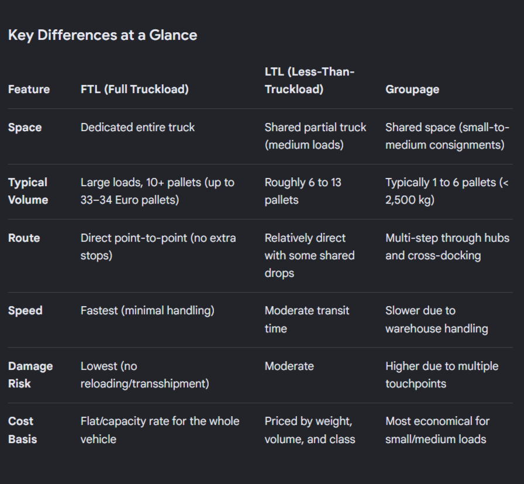
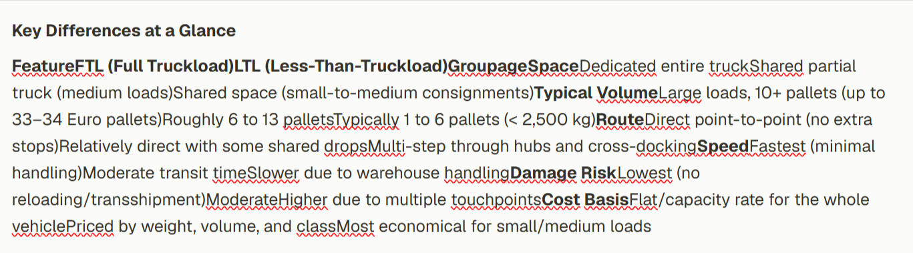

When I copy a table (e.g. from a Google search result) and paste it into a node, the table structure is lost. Rows, columns and cell breaks collapse into one run-on paragraph ("FeatureFTL (Full Truckload)LTL…"); only bold survives. Not manageable for real content.

**Ask:** table support in nodes, so pasted tables keep their rows/columns (and ideally can be edited as tables).

**Source (what was copied):** 4-column comparison table: FTL vs LTL vs Groupage.

**Result in ToughBubble node (after paste):**

